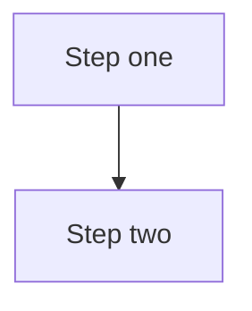

# Transcript to Notes

Convert raw lecture transcripts into clean markdown notes that a learner can revise from months later. A transcript is spoken language: repetitive, chronological, full of filler and speech-recognition mistakes. Good notes are the opposite: organized by concept, dense, and accurate.

## Inputs

- **Transcripts**: one file, several files, or a folder. For a folder, read every transcript file in it (sorted by filename, since lecture numbers are usually in the names) and ignore unrelated files.
- **Code files** (optional): code the user supplies because it cannot be deduced from the audio. Treat these as the source of truth for code.
- **User notes** (optional): the user's own key points, snippets, or remarks. Merge them into the notes (see "Merging user material").

If the user gives only a path or a folder, that is enough to start. Do not ask what format to use; the format is fixed below.

## Workflow

1. **Read everything first.** Load all transcripts, code files and user notes before writing. Concepts introduced in lecture 3 are often clarified in lecture 5, and you want the final understanding, not a running diary.
2. **Identify the topics.** List the real concepts, theories, tools, APIs, patterns and decisions discussed. Note where the instructor compares options, walks through a process, or demonstrates code.
3. **Check for gaps in code.** If the instructor demonstrates or describes code that you cannot reproduce faithfully from the transcript and the user did not supply it, collect these as questions (see "Missing code").
4. **Write the notes** following the format rules below.
5. **Report briefly** in chat: where the file was saved, and any open questions about missing code. Keep this to a few lines.

Output location: save next to the input (same folder as the single file, or inside the given folder) unless the user names a location. Name it after the content, for example `agent-loop-and-tools-notes.md`.

One file or many: for a single transcript, produce one notes file. For several transcripts or a folder, produce one consolidated notes file organized by concept, not by lecture, unless the user asks for one file per lecture. Consolidating is better because lectures in a section build on each other and separate files force the reader to jump around. If the files clearly belong to unrelated topics, split them by topic.

## What to keep and what to drop

Keep: definitions, how and why things work, the instructor's reasoning, theories and mental models, step-by-step procedures, parameters and defaults, tradeoffs, warnings and common mistakes, tool and library names, versions when stated, numbers that matter, and any example that illustrates a concept.

Drop: greetings, "in this lecture we will", recaps of the previous lecture, course logistics, promotions, requests for reviews, jokes, repeated explanations (keep the clearest version), timestamps and speaker labels.

Fix speech-recognition errors in technical terms using your knowledge of the field (for example "lang graph" is LangGraph, "pie torch" is PyTorch, "pandas data frame" is pandas DataFrame, "rag" in an LLM context is RAG). When a term is truly ambiguous, keep the transcript wording and flag it in your chat report rather than guessing silently.

Do not add facts the course did not cover. You may add a brief clarifying phrase when the instructor's wording is vague and the correct meaning is standard knowledge, but the notes should reflect what was taught. If the instructor says something that is wrong or outdated, keep it faithful but flag it in the chat report.

## Format rules

These are hard requirements from the user.

- **Structure**: a single `#` title, then `##` sections and `###`/`####` subsections. Order by logical flow of the topic (foundations before applications), not by transcript order.
- **Tables for comparisons**: whenever two or more things are contrasted (tools, approaches, parameters, pros and cons, before/after), use a markdown table. Do not describe comparisons in prose or bullets.
- **No summary blocks**: no "Summary", "TL;DR", "Key Takeaways", "Conclusion", "Recap" or "In short" sections, and no closing paragraph that restates the content. End the notes when the content ends.
- **Bullets sparingly**: use prose paragraphs for explanations and bullets only for genuinely list-shaped content (steps, enumerations, parallel properties). A section made entirely of bullets is a sign it should be prose or a table.
- **No emojis.**
- **No em-dashes or en-dashes.** Use commas, colons, parentheses or separate sentences instead. Use plain hyphens only for compound words and list markers. Before finishing, search the file for the characters U+2014 and U+2013 and replace any found.
- **Mermaid diagrams**: when a process, pipeline, agent loop, architecture, data flow or decision flow is described, draw it in a fenced block tagged `mermaid`. Only add a diagram when it clarifies something; do not decorate. Keep labels short, avoid special characters that break parsing (wrap labels containing parentheses or punctuation in double quotes), and avoid em-dashes inside labels too.
- **Code**: fenced blocks with a language tag, preserved exactly as supplied. Put a one-line lead-in before a block saying what it does, and explain non-obvious lines in prose below it.
- **Inline formatting**: bold a term at its first definition; use backticks for identifiers, parameters, commands, file names and model names.

Why these rules matter: the notes are for quick revision and likely live in a notes app or repo. Tables and diagrams make relationships scannable, and summary blocks just duplicate what the reader has already read.

## Missing code

Transcripts often say "as you can see on screen" while typing code the audio never spells out. Handle it this way:

- If the user supplied the code, use it verbatim.
- If the instructor dictates the code clearly and completely (spelling out the function name, arguments and body), reconstruct it.
- If the code is only described or partly dictated (for example "we create the agent with a couple of tools and a system prompt"), do not invent it. Write the concept in prose, leave out the code block, and add the item to a list of questions for the user.

Do not scatter placeholders like `# TODO` through the notes. Instead, finish the notes without that code and, in your chat report, list each missing piece with its lecture or topic and what you would need, for example: "Lecture 4, the tool-calling loop: the instructor builds it on screen but only describes it. Can you share the code?" Ask once, as a single batch, after producing the notes, so the user can send the code and you can slot it in. If the missing code is central to the notes (the whole lesson is about it), it is fine to ask before writing instead.

## Merging user material

- User notes and the transcript cover the same ground from two angles. Weave them together under the right headings instead of appending the user's notes as a separate section.
- If they agree, state the point once. If they conflict, follow the transcript for what the instructor said, and mention the discrepancy in the chat report.
- User code overrides anything you would reconstruct. User-written remarks (for example "gotcha: this fails on Windows") are valuable; keep them, phrased as part of the relevant section.

## Calibrating depth for technical topics

- Agentic AI and agentic coding: capture the agent loop, tool definitions, memory and state, planning and orchestration patterns, framework-specific concepts (LangGraph nodes and edges, MCP servers and clients, CrewAI roles, and so on), prompt and context-engineering advice, failure modes and guardrails.
- Generative AI and LLMs: capture mechanisms (tokens, embeddings, attention, sampling parameters), API usage, RAG components and chunking choices, fine-tuning versus prompting tradeoffs, evaluation methods.
- Data science and ML: capture the method, the intuition, assumptions, formulas (in LaTeX with `$...$` or `$$...$$` if the instructor writes them), metrics and when to use each, and library calls with their key parameters.
- Python: capture syntax, semantics, idioms and pitfalls, with small runnable examples.

A good note lets the reader answer "what is it, why does it exist, how do I use it, and what goes wrong" for each concept the instructor teaches.

## Skeleton (adapt, do not copy blindly)

```markdown
# Topic Title

## Core concept
Prose explanation. Define **key term** at first use.

### Sub-aspect
Explanation, then code if provided.

## Comparison of A and B
| Aspect | A | B |
|--------|---|---|
| ...    |   |   |

## How the process works

Explanation of each stage.
```

There is no summary section at the end of the skeleton on purpose.
